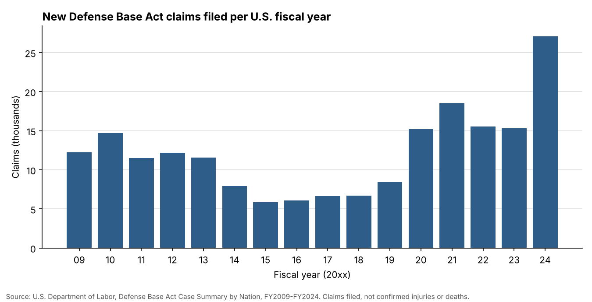

# contractor-injury-claims

[](https://doi.org/10.5281/zenodo.23746798)

Published by [Mercenomics](https://mercenomics.org), an independent data archive on the business of force for hire.

Claims filed under the U.S. **Defense Base Act**, the law that covers injured or killed civilian contractors working on U.S. government contracts overseas. The data comes from the U.S. Department of Labor and is organized by country and fiscal year, **FY2009 to FY2024**, plus the Labor Department's cumulative table for **2001 to 2024**.



## What this is and why it matters

Civilian contractors do much of the work behind U.S. government operations abroad, and some of them are injured or killed. Their families and employers file compensation claims under the Defense Base Act, and the U.S. Department of Labor counts these claims by country and year. Official casualty figures usually cover only soldiers, so these tables are one of the few public records of harm to civilian contractors: more than 235,000 claims since 2001, including about 4,200 death claims.

The tables were spread across many separate web pages and spreadsheets, with country names spelled differently from year to year. This repository brings them into one checked dataset and states clearly what the numbers do and do not show. It can be used to see where and when contractor work has been most dangerous, to follow how risk changed as wars ended, to inform the cost of insuring overseas contract work, and to check public claims about contractor injuries and deaths.

## Read this first

- **These are claims, not casualties.** Each number is a new case opened by the Labor Department in that year. The Labor Department states that these numbers are not official casualty statistics, and do not show the number of injuries or deaths that happened in the period.
- **The year is when the case was opened**, not when the injury happened. For example, Afghanistan still has thousands of claims in FY2024, after the U.S. withdrawal in 2021.
- **The country is where the injury happened**, not the worker's nationality.
- **A blank cell is not zero.** The Labor Department leaves small numbers out of its tables. Blank cells are kept blank, so adding up countries gives less than the printed year total. The yearly totals file has the official totals.
- **"Nation Pending"** means the country was not yet recorded when the table was made.

## The data

| File | Contents |
|---|---|
| [`data/clean/dba_claims_by_country_year.csv`](data/clean/dba_claims_by_country_year.csv) | One row per country per year (1,433 rows) |
| [`data/clean/dba_claims_year_totals.csv`](data/clean/dba_claims_year_totals.csv) | The total printed for each year, and for 2001-2024 |
| [`data/clean/dba_claims_cumulative_2001_2024.csv`](data/clean/dba_claims_cumulative_2001_2024.csv) | The cumulative table, one row per country |

| Column | Meaning |
|---|---|
| `fiscal_year` | U.S. fiscal year the case was opened (starts 1 October) |
| `country` | Standard country name (spellings vary between years in the source) |
| `country_in_source` | The name exactly as printed |
| `no_lost_time` | Cases with no time lost from work |
| `lost_time_3_days_or_less` | Lost time of 3 days or less |
| `lost_time_4_days_or_more` | Lost time of 4 days or more |
| `death` | Death cases |
| `salary_continuation` | Cases where the employer may be continuing pay |
| `other` | Other cases |
| `total` | All cases |
| `source_url` | The Labor Department page or file the row comes from |

Case types follow the Labor Department's definitions. They show what compensation *may* be payable, not what was paid.

## Things to know before comparing years

- FY2009-FY2020 come from web tables; FY2021-FY2024 come from spreadsheets. Both list the same case types under slightly different names (for example `LTO` and `SUM(LTO3)`), which are matched here.
- The tables were published once a year and are not revised later. The cumulative 2001-2024 table is newer, so the yearly numbers do not always add up to it. For example, "Nation Pending" is 56 lower in the cumulative table, because some cases were later assigned a country.
- Total claims rose by 80% in FY2020 and 77% in FY2024. Both match the totals printed by the Labor Department; this repository does not test why.

## How the numbers were checked

Run by [`code/02_check_claims.py`](code/02_check_claims.py); results in [`data/clean/check_report.md`](data/clean/check_report.md).

1. The tables were copied cell by cell from the Labor Department's pages and spreadsheets, and the copy was verified with a checksum.
2. Each year's countries were compared with the total printed for that year. They match exactly for FY2023 and FY2024; in other years the gap equals the claims in cells the source leaves blank.
3. Each row's case types were checked against its total.
4. The yearly tables were compared with the cumulative 2001-2024 table.
5. Large year-to-year changes were listed for review.

## Reproduce it

```
pip install -r requirements.txt
python code/01_build_claims.py
python code/02_check_claims.py
python code/03_make_figure.py
```

## Sources and license

Sources are listed in [`data/README.md`](data/README.md). Code: MIT (see [`LICENSE`](LICENSE)). The clean dataset: CC BY 4.0. The source tables are U.S. government works.

## Used in

Azom, Kazi Affnann (2026). "Who Bears the Risk of Privatized War? Troops, Contractors and Third-Country Nationals." Preprint. Zenodo. https://doi.org/10.5281/zenodo.23788239

## Cite

Azom, Kazi Affnann (2026). *contractor-injury-claims: U.S. Defense Base Act claims by country, FY2009-FY2024* (Version v1.0.0) [Data set]. Mercenomics. https://doi.org/10.5281/zenodo.23746799

- This version (v1.0.0): [10.5281/zenodo.23746799](https://doi.org/10.5281/zenodo.23746799)
- All versions (always points to the latest): [10.5281/zenodo.23746798](https://doi.org/10.5281/zenodo.23746798)

See also [`CITATION.cff`](CITATION.cff).
